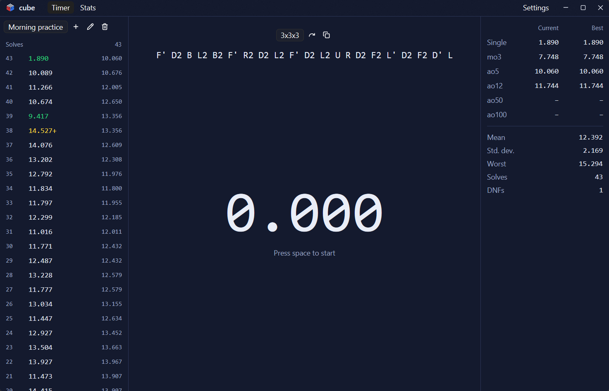

<p align="center"></p>

<h1 align="center">cube</h1>

<p align="center">A desktop timer and session manager for speedcubing, built with Rust and <a href="https://gpui-kit.com/docs/">GPUI Kit</a>.</p>



cube is the graphical sibling of [cube-tui](https://github.com/enekocm7/cube-tui). Both apps read and write the same
solve history, so you can move between the terminal and the desktop without importing anything.

## Features

- Timer with WCA inspection that counts up to 15 seconds: `+2` and DNF are applied automatically, optional 8 s and
  12 s audio cues warn you, and hold colors work like a stackmat's
- Official WCA random-state scrambles for 12 events, generated with `tnoodle-rs`
- Sessions with custom names
- Solve history, with details you can edit (time, event, scramble, penalty, date and comment) and a full audit trail of every change
- Current and best single, mo3, ao5, ao12, ao50 and ao100, plus mean, deviation and DNF count
- Stats screen with charts of your times, your ao5 and their distribution
- Import and export csTimer sessions, with file pickers, from Settings → Data
- Checks GitHub for new releases and updates itself, verifying the download against the release's SHA-256
- Light and dark themes, in English and Spanish

Features still on the way are tracked in the [issues](https://github.com/enekocm7/cube-gui/issues).

## Install

Download the installer or a portable build from the [releases](https://github.com/enekocm7/cube-gui/releases) page.
Installed builds update themselves silently; portable builds swap the executable and restart. Both wait for you to
accept an update, and the download is checked against the release's `SHA256SUMS` file before anything is installed.
Turn the automatic check off, change its frequency or release channel, or check manually from
**Settings → Updates**.

To build from source, install [Rust](https://rustup.rs/) and run:

```sh
cargo run --release
```

## How to use it

| Key | Action |
|---|---|
| `Space` | Start inspection, or hold and release to start the solve, and press to stop |
| `Esc` | Cancel the current attempt without recording it |

Click a solve in the list to see its details or edit it.

The "Press space to start" hint is only shown until you start your first solve, so the timer stays clean once you
know the controls.

Open **Settings → Data** to import a csTimer export or to export every session. Importing adds the
file's sessions to your history, infers each solve's event from its scramble, and keeps penalties and
comments; solves that can't be read are skipped and counted in the notification.

## Your data

Solves are stored in cube-tui's `times.json`, in your user data folder (`%APPDATA%\cube-tui` on Windows). Settings for
this app are in `cube-gui.toml` in the same folder. Debug builds use a `debug` subfolder, and the `CUBE_DATA_DIR`
environment variable overrides the location.

If `times.json` can't be read, cube says so and turns saving off, so the file is never overwritten.

Don't keep cube and cube-tui open at the same time: each one overwrites the file with what it has in memory.

## Project layout

| Crate | Contents |
|---|---|
| `cube-gui` (root) | The `cube` binary and icon embedding |
| `crates/cube-core` | Solves, statistics, the timer state machine, scrambles and persistence, with no GUI dependency |
| `crates/cube-locale` | Translated strings |
| `crates/cube-updater` | GitHub release check, verified download and self-update |
| `crates/cube-ui` | The GPUI interface |

## License

[GPL-3.0-or-later](LICENSE).
