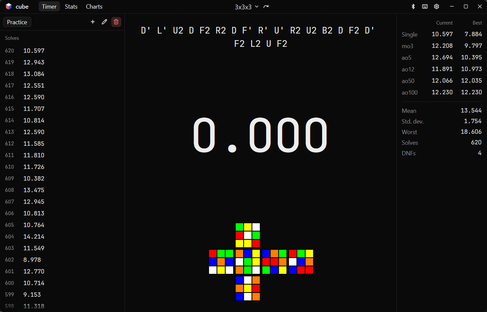

<p align="center"></p>

<h1 align="center">cube</h1>

<p align="center">A desktop timer and session manager for speedcubing, built with Rust and <a href="https://gpui-kit.com/docs/">GPUI Kit</a>.</p>

<p align="center"><a href="https://enekocm7.github.io/cube-app/">Website and docs</a> · <a href="https://github.com/enekocm7/cube-app/releases">Releases</a></p>



cube times your solves with WCA inspection, generates official scrambles, and keeps a history you can search, edit and
chart. It is fully usable from the keyboard.

It is the graphical sibling of [cube-tui](https://github.com/enekocm7/cube-tui). Both apps read and write the same
solve history, so you can move between the terminal and the desktop without importing anything.

**Contents:** [Get started](#get-started) · [Keyboard shortcuts](#keyboard-shortcuts) · [Features](#features) ·
[Settings](#settings) · [Themes](#themes) · [Your data](#your-data) · [Updates](#updates) ·
[Build from source](#build-from-source) · [Contributing](#contributing)

## Get started

1. Download the build for your system from the [releases](https://github.com/enekocm7/cube-app/releases) page.

   | System | Download |
   |---|---|
   | Windows x64 | The installer, or the portable `.zip` |
   | Linux x64 | The `linux-x64` `.tar.gz` |
   | macOS (Apple silicon) | The `macos-arm64` `.tar.gz` |

2. Start cube. On Windows, run the installer and open cube from the Start menu. On Linux and macOS, unpack the archive and run `cube`.
3. Press and hold `Space` until the timer turns green, then release to start the solve. Press any key to stop it.
   With inspection on (the default), the first `Space` starts the 15 second inspection and the next hold starts the solve.
4. Your solve appears in the list on the left. Press `N` for a new scramble and keep going.

Press `F1` at any time to see every shortcut.

## Keyboard shortcuts

cube is designed to be fully usable from the keyboard. Every action below has a shortcut, and any of them can be
changed or removed. The [keyboard reference](https://enekocm7.github.io/cube-app/docs/keybinds/) is the full reference, with the key name syntax and the rules
for valid bindings.

| Key | Action |
|---|---|
| `Space` | Start inspection, hold and release to start the solve, press to stop |
| Any other key | Stop a running solve |
| Left mouse button or touch on the digits | Same as the timer key when **Timer → Touch the digits** is on (off by default) |
| `Esc` | Cancel the current attempt without recording it, or leave the stats, charts, goals, trainer, library, Multi-Blind or Relays screen |
| `N` | New scramble (hold to keep generating) |
| `I` | Turn WCA inspection on or off |
| `P` | Show or hide the scramble preview |
| `M` | Turn manual mode on or off |
| `Up` / `Down` | Select a newer or older solve (hold to keep moving) |
| `Enter` | Open the selected solve's details |
| `D` | Delete the selected solve |
| `2` | Toggle `+2` on the selected solve |
| `Shift + D` | Toggle DNF on the selected solve |
| `T` | Tag the selected solve |
| `Shift + T` | Choose tags for the next solves |
| `Ctrl + T` | Rename or delete tags |
| `E` / `Shift + E` | Next / previous event |
| `]` / `[` | Next / previous session |
| `S` | New session |
| `F2` | Rename session |
| `Shift + S` | Delete session |
| `Ctrl + Z` | Undo the last solve or session deletion (repeatable) |
| `Ctrl + Y` | Redo an undone deletion |
| `Left` / `Right` | Select a shorter or longer average |
| `O` / `Shift + O` | Open the selected average, or its best |
| `C` | Copy the selected average as text |
| `K` / `Shift + K` | Create an image of the selected solve or average |
| `U` | Copy an alg.cubing.net link to the selected solve |
| `A` | Show stats, or return to the timer |
| `G` | Show charts, or return to the timer |
| `B` | Connect or disconnect a Bluetooth timer |
| `Shift + G` | Show goals, or return to the timer |
| `Shift + N` | New goal, on the goals screen |
| `Shift + P` | Show the trainer, or return to the timer |
| `Y` | Next algorithm set, in the trainer |
| `J` | Select or clear the highlighted case, in the trainer |
| `Shift + J` | Select or clear the highlighted case's group, in the trainer |
| `Shift + A` | Select or clear every case, in the trainer |
| `Q` | Start training the selected cases |
| `H` | Show or hide the current case, in the trainer |
| `Shift + H` | Open the highlighted case in the library, from the trainer |
| `Shift + Y` | Sort cases by slowest, in the trainer |
| `Shift + Q` | See the highlighted case's attempts, in the trainer |
| `3` | Select the cases you are learning, in the trainer |
| `4` | Select the cases due for review, in the trainer |
| `Shift + B` | Show the library, or return to the timer |
| `Shift + U` | Next puzzle, in the library |
| `5` | Train the highlighted case in the trainer, from the library |
| `Shift + X` | Change the highlighted case's status, in the library |
| `Shift + F` | Make the highlighted algorithm your favourite, in the library |
| `Shift + I` | Add an algorithm, in the library |
| `.` | Edit the highlighted case's note, in the library |
| `Shift + W` | Start the library's review |
| `Ctrl + Shift + B` | Show or hide the set in the library |
| `Ctrl + Shift + P` | Include or exclude the set in training |
| `6` / `7` / `8` / `9` | Grade a review: again, hard, good or easy |
| `Shift + M` | Show Multi-Blind, or return to the timer |
| `Shift + C` | Copy the Multi-Blind scrambles |
| `Shift + V` | Save the Multi-Blind scrambles to a text file |
| `Ctrl + R` | Show Relays, or return to the timer |
| `1` | Select the next relay, on the Relays screen |
| `Ctrl + E` | Create a custom relay, on the Relays screen |
| `Ctrl + D` | Delete the selected custom relay, on the Relays screen |
| `Ctrl + B` | Copy the relay's scrambles, on the Relays screen |
| `Ctrl + L` | Switch the timer key between stopping the relay and ending each puzzle |
| `/` | Jump to the search field in the shortcuts, settings, trainer and library |
| `V` | Show the next charts view |
| `F` | Filter charts by the next event |
| `R` / `Shift + R` | Filter charts by the next range, or by custom dates |
| `L` | Filter stats and charts by the next tag |
| `Shift + L` | Compare with the next tag, on the Tags chart |
| `W` | Chart one session or all of them |
| `Z` / `Shift + Z` | Zoom the times chart in or out |
| `X` | Reset the times chart zoom |
| `Ctrl + ,` | Open settings |
| `F1` | Open the keyboard shortcuts |

Actions that need a solve use the keyboard selection, or the latest solve when nothing is selected. You can also click
a solve in the list, or a single in the stats panel, to see its details or edit it.

Around the shortcuts:

- **Dialogs.** They are reachable with `Tab`, `Enter` and `Space`. `Enter` runs a dialog's primary action and `Esc`
  closes it.
- **Rebinding.** In the `F1` panel, **Edit** (opposite **Close**) shows a pencil to rebind an action and a trash can to
  remove its shortcut. You can also edit the `[keybindings]` table in `cube-app.toml` by hand.
- **Settings.** `Up` and `Down` move through the categories, and `Tab` or `Right` moves into the settings.
- **Search.** The shortcuts panel and the settings dialog both have a search field. Press `/` to jump to it (you can change the key), or
  reach it with `Tab`. Type to filter rows by label or current value, such as `space`, `ctrl` or `unassigned` for
  shortcuts, or `dark` or `off` for settings. Matching ignores case and uses the interface language.
- **Start hint.** The "press to start" hint is shown only until your first solve, and names whichever key the timer is
  bound to.

## Features

**Timing**

- WCA inspection that counts up to 15 seconds. `+2` and DNF are applied automatically.
- Optional audio cues at 8 s and 12 s of inspection.
- A flash on the digits and an optional sound for a new personal best.
- Hold colors that work like a stackmat's.
- Start and stop with the keyboard, optionally with the mouse or touch.
- GAN Bluetooth timers: connect one and its solves are recorded on their own.

**Scrambles**

- Official WCA random-state scrambles for 16 events, including 3x3x3 One-Handed and the blindfolded events, generated with `tnoodle-rs`.
- A picture of the scrambled puzzle on the timer and in the solve details. Turn it off with `P`.

**Blindfolded**

- 3x3x3, 4x4x4 and 5x5x5 Blindfolded, with no inspection and a key press to split memo from execution.
- Success rate, best single, mean of 3 and memo and execution averages in place of ao5 and longer.
- Multi-Blind: pick the cubes, copy or save the scrambles, time the attempt and enter how many you solved, scored under WCA rules. Attempts can be edited or deleted.

**Relays**

- Time several puzzles as one attempt, with a split for each: a dropdown of presets such as 2x2x2 to 7x7x7, or a custom list of events.
- See every scramble before starting, one inspection for the whole relay, and a key to end each puzzle or to stop the whole relay.
- Total, splits, best and mean per relay, with a `+2` or DNF on any puzzle.

**Trainer**

- Drill any set of the library, on every puzzle: pick whole sets or single cases, or those you are learning or that are due, with slower cases coming up more often.
- Train the stages of a solve: the last layer, F2L with the cross solved, or one chosen slot.
- Results move cases along in the library: their status and review date.
- Past attempts of each case, which can be reviewed and deleted.
- Search for cases by name or group.
- A history that names the case of each attempt, and per-case stats sorted by slowest.
- A book on each case opens it in the library, to add your own algorithm.

**Library**

- Algorithm sets for every puzzle, browsed by puzzle, method and set, with search.
- A drawing, setup moves, algorithms and a status for each case, with your own algorithms, favourite and note.
- A spaced-repetition review of the cases you have learned.
- Hide a set from the library or leave it out of the trainer, per set or by puzzle or method, in settings.

**Sharing**

- Result images: a single or an average up to ao12 as a card in your theme, with a preview to copy or download as a PNG.
- alg.cubing.net links with the scramble and any solution you typed.

**Solves and sessions**

- Manual mode to type in times from another timer.
- Sessions with custom names, deletable from the session dropdown.
- A solve history whose details you can edit: time, event, scramble, penalty, date, comment and solution. Every change is kept
  in an audit trail.
- Undo and redo for deleted solves and sessions.
- Tags on solves, such as the cube or method used, to filter stats and charts and compare two side by side.

**Statistics**

- Current and best single, mo3, ao5, ao12, ao50 and ao100, plus mean, deviation and DNF count.
- Practice goals: solves per day or week, a target time or a streak, with progress on the timer screen.
- A stats screen with a heat-mapped table of every solve's rolling averages. Click a value, in the table or the stats
  panel, to see the solves behind it and how far each landed from the average, with the trimmed ones marked. Copy an
  average as text to share it.
- A charts screen with your times, ao5, ao12 and ao100, personal bests, DNFs and the distribution of your times.
- Chart filters by session, event, last solves and dates.
- Zoom on the times chart with the mouse wheel.
- A calendar of solves per day, a comparison of sessions and your all-time bests per event.

**Interface**

- Light and dark themes, plus cube-tui TOML themes with a color-picker editor. See [Themes](#themes).
- Bundled Cube Mono, [JetBrains Mono](https://github.com/JetBrains/JetBrainsMono) with a plain zero, for all times.
  You can use it for the timer digits only, for the whole interface, or use the system font instead.
- Sixteen languages, including English, Spanish, German, French, Japanese and Chinese. Dates and counts follow the
  chosen language.
- Resizable solve list and statistics panels. Drag the inner edge of a panel to resize it (180 to 350 px) and
  double-click the edge to restore its default width.
- Dialogs size themselves to the window. Settings, solve details and the theme editor grow on a large screen and
  scroll their bodies when the window is small.
- The window's size, position and maximized state are remembered. If the monitor it was on is gone, cube opens
  centered at the default size.

**Data**

- Import and export csTimer sessions with file pickers. See [Import and export](#import-and-export).
- The history is shared with cube-tui. See [Your data](#your-data).

Features still on the way are tracked in the [issues](https://github.com/enekocm7/cube-app/issues).

## Settings

Open settings with `Ctrl + ,`. They are saved to `cube-app.toml` (see [Your data](#your-data)).

Pick a category on the left to see its settings on the right.

| Category | What you can change |
|---|---|
| **General** | Sixteen languages, including English and Spanish, notifications, and confirmation before deleting |
| **Timer** | WCA inspection, its 8 s and 12 s audio cues, personal best celebrations, touching the digits to start or stop, shorter 3x3x3 scrambles (slower to generate) and the scramble preview |
| **Appearance** | Light, dark or system and your theme files (see [Themes](#themes)), font and sizes with presets and a custom point size, ao5 in the solve list, and an always-visible solve list scrollbar |
| **Library** | Show each algorithm set in the library, include it in the trainer, or both. Puzzles and methods have dropdowns with a switch for the whole group. See [Algorithm library](#algorithm-library) |
| **Keyboard shortcuts** | Opens the `F1` panel, where shortcuts are rebound. See [Keyboard shortcuts](#keyboard-shortcuts) |
| **Data** | Import and export csTimer sessions, and choose your own backup folder. See [Your data](#your-data) |
| **Updates** | Automatic checks, release channel and check frequency. See [Updates](#updates) |

Details worth knowing:

- **Font.** Times use the bundled Cube Mono by default. **Appearance → Font** can limit it to the timer, extend it to
  the whole interface, or switch to the system fonts. The font is bundled under the SIL Open Font License.
- **Text size.** **Appearance → Text size** picks Small, Normal (default), Large, Largest or Custom, which takes an exact
  size in points (8 to 24). It changes the interface text without changing the panels and dialogs around it.
- **Timer size.** **Appearance → Timer size** picks Small, Normal (default), Large, Largest or Custom, which takes an
  exact size in points (24 to 240) for the timer's digits.
- **Scramble size.** **Appearance → Scramble size** picks Small, Normal (default), Large, Largest or Custom, which takes
  an exact size in points (6 to 120). Long scrambles still scroll.
- **Library size.** **Appearance → Library size** picks Small, Normal (default) or Big for the case rows, drawings and
  panels in the library.
- **Scramble preview.** The preview draws the puzzle as the scramble leaves it, under the timer and in the solve
  details, where it follows the scramble you are editing. Turn it off with **Timer → Show the scramble preview**,
  or toggle it with `P`.
- **Sizes per event.** **Appearance → Sizes per event** opens a dialog that sets the preview, timer and scramble size
  of each event.
- **Set visibility.** **Library** lists every puzzle with **Show in library** and **Include in training** switches that
  apply to all its sets. Open a puzzle and then a method to change single sets. Both are on by default.
- **Scrollbar.** The solve list scrollbar appears only while you scroll. Turn on **Appearance → Always show the solve
  list scrollbar** to keep it visible.

## Themes

cube reads the same theme files as [cube-tui](https://github.com/enekocm7/cube-tui), so a theme works in both apps.
They live in the `themes` folder inside your [data folder](#your-data).

In **Settings → Appearance**, every valid theme is listed. Pick one to apply it, use the pencil to edit it, the trash can
to delete it, or **New theme** to create one. Themes you add to the folder appear the next time the dialog opens.

A theme is a TOML file of six-digit colors:

```toml
background = "#000000"
border = "#FFFFFF"
scramble = "#FFFFFF"
selection = "#3399FF"
selection_text = "#000000"
text = "#FFFFFF"
accent = "#FFD700"
```

- `accent` is optional and defaults to gold, so older cube-tui themes keep working.
- cube creates `default.toml` the first time it makes the themes folder. A deleted theme is not recreated.
- The editor has a color picker for each of the seven colors, a text field that switches between Hex, RGB, RGBA, HSL
  and HSLA, and a live preview.
- Rename a theme by changing its name. cube saves it as `<name>.toml`.
- Theme files store opaque colors, so an alpha value typed into an RGBA or HSLA field is ignored when saving.

## Your data

| What | File | Shared with cube-tui |
|---|---|---|
| Solves and sessions | `times.json` | Yes |
| This app's settings | `cube-app.toml` | No (cube-tui uses `config.toml`) |
| Themes | `themes/` | Yes |
| Backups of your solves | `backups/` | No |

They are all in the same folder, cube-tui's data folder:

| System | Data folder |
|---|---|
| Windows | `%APPDATA%\cube-tui` |
| Linux | `~/.local/share/cube-tui` |
| macOS | `~/Library/Application Support/cube-tui` |

Debug builds use a `debug` subfolder. The `CUBE_DATA_DIR` environment variable replaces the location entirely.

cube and cube-tui can run at the same time: cube merges what cube-tui saved and tells you when it does. A solve only
leaves your history when you delete it in cube, so close cube before deleting one in cube-tui.

You can also choose a backup folder of your own in **Settings → Data**, such as a synced or external drive. It gets
the same automatic backups, plus a **Back up** button for copies that are never removed.

To restore a backup, close both apps and copy it over `times.json`.

If `times.json` exists but can't be read, cube says so and turns saving off, so the file is never overwritten.

### Import and export

Open **Settings → Data** to import a csTimer export or to export every session.

- Importing adds the file's sessions to your history, infers each solve's event from its scramble, and keeps
  penalties and comments.
- Solves that can't be read are skipped and counted in the notification.

## Updates

cube checks GitHub for new releases and can update itself. It waits for you to accept an update, and checks the
download against the release's SHA-256 checksums before installing anything.

- **Installed builds** (Windows installer) update silently.
- **Portable builds** swap the executable and restart.

Under **Settings → Updates** you can turn the automatic check off, set how often it runs (every start, daily or
weekly), choose the stable or pre-release channel, check manually, and clear a version you chose to skip.

## Build from source

You need [Rust](https://rustup.rs/) (stable). Then, from the repository root:

```sh
cargo run --release
```

On Linux you also need GPUI's system libraries. The package list for Ubuntu 24.04 is in the
[release workflow](.github/workflows/release.yml), and comes from the
[GPUI Kit install guide](https://gpui-kit.com/docs/).

## Contributing

```sh
cargo test --workspace
cargo check --workspace --all-targets
cargo fmt --all
cargo clippy --workspace --all-targets -- -D warnings
```

[AGENTS.md](AGENTS.md) describes the conventions, including the keyboard rules, the shared save format and how to
open a pull request.

| Crate | Contents |
|---|---|
| `cube-app` (root) | The `cube` binary and icon embedding |
| `crates/cube-core` | Solves, statistics, the timer state machine, scrambles and persistence, with no GUI dependency |
| `crates/cube-locale` | Translated strings |
| `crates/cube-updater` | GitHub release check, verified download and self-update |
| `crates/cube-ui` | The GPUI interface |

Scramble timings and the reasoning behind the queue are in [Scramble performance](https://enekocm7.github.io/cube-app/docs/scramble-performance/).

## License

[GPL-3.0-or-later](LICENSE).
